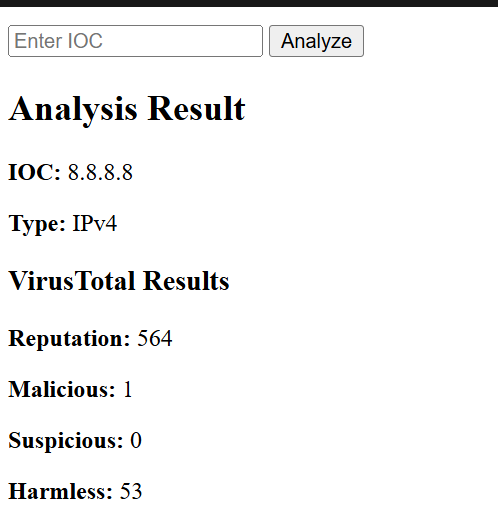
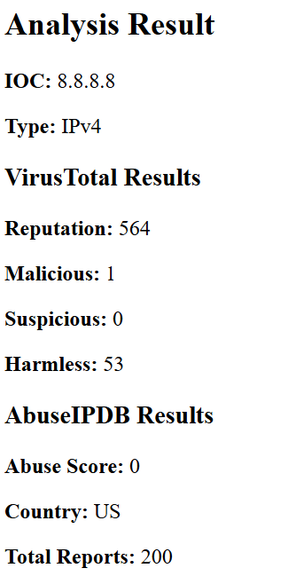
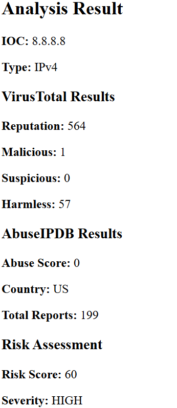
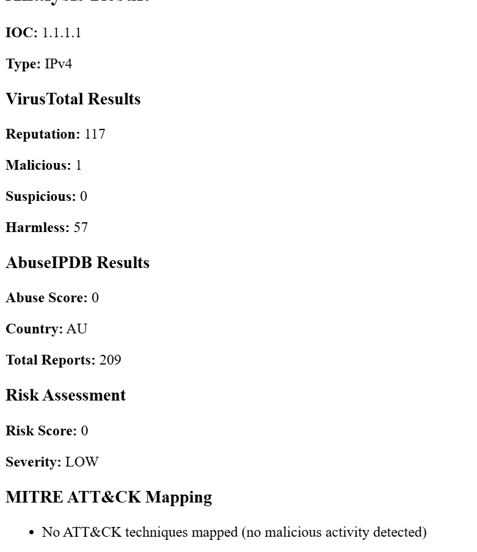
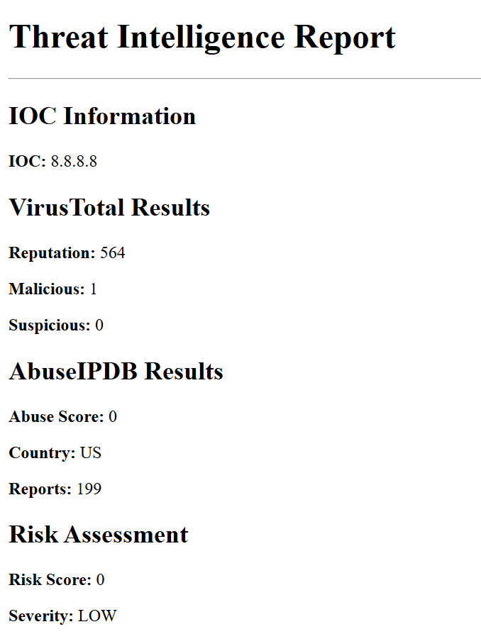
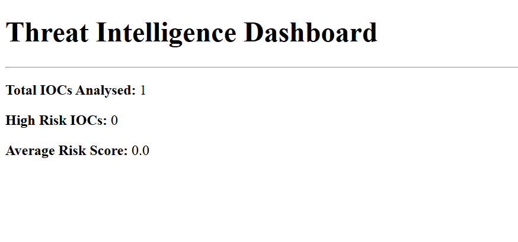

# Threat Intelligence Module

A Python-based threat intelligence enrichment platform designed to identify, enrich, analyse and assess Indicators of Compromise (IOCs).

The application classifies user-supplied IOCs, enriches them using real-world threat intelligence sources, calculates risk scores, maps findings to MITRE ATT&CK techniques, generates threat intelligence reports and tracks analysis statistics through a dashboard.

---

## Features

### IOC Detection & Validation

Supports identification of:

- IPv4 Addresses (validated, with private/internal IPs such as `192.168.x.x` recognised and not looked up)
- Domains
- URLs
- MD5 Hashes
- SHA1 Hashes
- SHA256 Hashes

---

### VirusTotal Integration

Enriches indicators using VirusTotal intelligence.

Provides:

- Reputation Score
- Malicious Detections
- Suspicious Detections
- Harmless Detections

---

### AbuseIPDB Integration

Performs IP reputation analysis using AbuseIPDB.

Provides:

- Abuse Confidence Score
- Country Information
- Total Reports

---

### Risk Scoring Engine

Calculates overall IOC risk levels using intelligence gathered from multiple sources.

Severity Levels:

- LOW
- MEDIUM
- HIGH
- CRITICAL

---

### MITRE ATT&CK Mapping

Maps threat intelligence findings to relevant MITRE ATT&CK techniques.

Examples include:

- T1071 – Application Layer Protocol
- T1110 – Brute Force
- T1595 – Active Scanning

---

### Intelligence Report Generation

Generates HTML intelligence reports containing:

- IOC Information
- Threat Intelligence Findings
- Risk Assessment
- MITRE ATT&CK Mappings

---

### Dashboard & Statistics

Tracks key intelligence metrics including:

- Total IOCs Analysed
- High-Risk IOCs (risk score of 60 or above)
- Average Risk Score

---

## Technologies Used

- Python
- Flask
- VirusTotal API
- AbuseIPDB API
- Requests
- Jinja2
- python-dotenv
- HTML

---

## Project Structure

```text
Threat_Intelligence_Module/
│
├── dashboard/
│   ├── __init__.py
│   └── statistics.py
│
├── Reports/
│   └── report_generator.py
│
├── integrations/
│   ├── abuseipdb.py
│   └── virustotal.py
│
├── mitre/
│   └── mapper.py
│
├── parsers/
│   └── ioc_parser.py
│
├── scoring/
│   └── risk_engine.py
│
├── templates/
│   ├── dashboard.html
│   ├── index.html
│   └── report.html
│
├── screenshots/
│
├── app.py
├── .env.example
├── requirements.txt
├── LICENSE
└── README.md
```

---

## Threat Intelligence Workflow

```text
User IOC
    ↓
IOC Detection
    ↓
VirusTotal Enrichment
    ↓
AbuseIPDB Enrichment
    ↓
Risk Scoring Engine
    ↓
MITRE ATT&CK Mapping
    ↓
Report Generation
    ↓
Dashboard Statistics
```

---

## Screenshots

### VirusTotal Integration



### AbuseIPDB Integration



### Risk Scoring Engine



### MITRE ATT&CK Mapping



### Intelligence Report Generation



### Dashboard & Statistics



---

## Installation

### Clone The Repository

```bash
git clone https://github.com/mangle-fnaf/Threat_Intelligence_module.git
```

### Move Into The Project Directory

```bash
cd Threat_Intelligence_module
```

### Install Dependencies

```bash
pip install -r requirements.txt
```

### Configure Environment Variables

Both APIs offer free keys for personal use:

- VirusTotal: create a free account at [virustotal.com](https://www.virustotal.com/) and copy your API key from your profile
- AbuseIPDB: create a free account at [abuseipdb.com](https://www.abuseipdb.com/) and create a key under **My API**

Copy `.env.example`, rename the copy to `.env`, and add your keys:

```env
VT_API_KEY=your_virustotal_api_key
ABUSEIPDB_API_KEY=your_abuseipdb_api_key
```

### Run The Application

```bash
python app.py
```

### Open In Browser

```text
http://127.0.0.1:5000
```

---

## Security Notes

- API keys are stored securely using environment variables.
- Sensitive credentials are excluded from source control using `.gitignore`.
- No secrets are hardcoded into the application.

---

## Limitations

- Only IPv4 addresses are currently enriched. Domains, URLs and hashes are detected but not yet looked up.
- The free VirusTotal API allows 4 lookups per minute and 500 per day; the free AbuseIPDB plan allows 1,000 checks per day.
- Dashboard statistics are stored in memory, so they reset when the application restarts.
- MITRE ATT&CK mappings are based on reputation scores rather than observed attacker behaviour, so they indicate likely techniques rather than confirmed ones.
- The app runs Flask in debug mode and is intended for local use only.

---

## Future Improvements

- Enrichment for domains, URLs and file hashes
- Additional Threat Intelligence Providers
- IOC History Tracking
- PDF Report Export
- Interactive Dashboard Visualisations
- Threat Hunting Automation
- Integration Into ThreatHunter SIEM

---

## Author

Maliyka Liaqat
Developed as part of the ThreatHunter SIEM cybersecurity portfolio project.